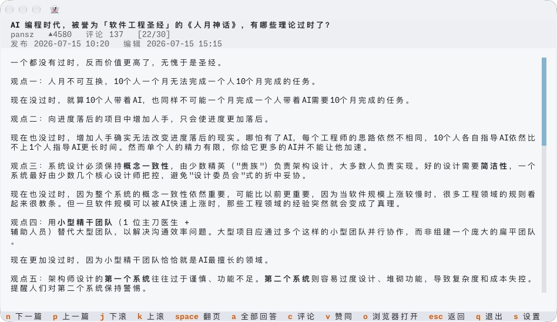

<p align="center">
  
</p>

<h1 align="center">zhihu-tui</h1>

> 又一个知乎爬虫,只是个小工具。

在终端里刷知乎的小玩意,平时摸鱼用。写得比较随意,能用就好,有问题欢迎提 issue,也欢迎指点。

命令是 `zh`,界面用 [Textual](https://github.com/Textualize/textual) 搭的,知乎的数据请求直接复用了 [pyzhihu-cli](https://github.com/BAIGUANGMEI/zhihu-cli),站在前人肩膀上。

## 截图



## 给 Agent

把下面这段话整段复制,粘贴给你的 Agent(Claude Code、Codex 等),它会替你装好并带你登录:

```
请帮我安装并登录 zhihu-tui(https://github.com/starr-evan/zhihu-tui),按顺序执行:
1. 确认 Python 3.10 及以上,没有就先装好。
2. 执行 pipx install git+https://github.com/starr-evan/zhihu-tui;没有 pipx 就先 pip install --user pipx。
3. 执行 pipx install pyzhihu-cli,得到 zhihu 命令。
4. 执行 zhihu login --qrcode,把生成的二维码图片 ~/.zhihu-cli/login_qrcode.png 打开给我,我用知乎 App 扫码并确认,最多等 2 分钟,超时就重新生成。
5. 登录成功后执行 zhihu status 确认,再告诉我用 zh 启动,以及 1/2/3 切换标签、n/p 翻页、a 看全部回答、s 打开设置。
全程不要读取、打印或上传我的 Cookie,凭证只留在 ~/.zhihu-cli。
```

## 赞赏

就是个小工具,能帮到你已经很开心了。如果觉得顺手,方便的话可以请我喝杯咖啡,不方便也完全没关系,点个 star 或者提个 issue 一样是很大的鼓励。

<p>
  
  &nbsp;&nbsp;
  
</p>

## 能做什么

- 热榜、个性化推荐、收藏夹,三个标签来回切换
- 回答和文章在终端里直接阅读,支持加粗、引用、列表、公式、链接
- 图片和视频显示为可点击的链接,点一下用浏览器打开
- 显示发布时间和编辑时间
- 从任意一篇回答跳到它所属问题的全部回答
- 查看评论,赞同回答
- 5 套主题(浅色、深色、两套色盲友好、高对比),设置里切换
- 老板键 `m`,一键切成编译日志

## 安装

需要 Python 3.10 及以上。`pipx` 或 `pip` 都可以:

```
pipx install git+https://github.com/starr-evan/zhihu-tui
```

也可以从 [Releases](https://github.com/starr-evan/zhihu-tui/releases) 下载 wheel 安装:

```
pipx install ./zhihu_tui-0.2.0-py3-none-any.whl
```

本地开发:

```
git clone https://github.com/starr-evan/zhihu-tui
cd zhihu-tui
pip install -e .
```

## 使用

先用 pyzhihu-cli 登录一次,Cookie 会保存在本机 `~/.zhihu-cli`:

```
zhihu login --qrcode
```

然后启动:

```
zh
```

## 快捷键

| 位置 | 按键 |
|---|---|
| 首页 | `1` 热榜,`2` 推荐,`3` 收藏,`↑↓` 选择,`Enter` 进入,`r` 刷新,`s` 设置,`m` 老板键,`q` 退出 |
| 阅读 | `n`/`→` 下一篇,`p`/`←` 上一篇,`j`/`k` 滚动,`空格` 翻页 |
| 阅读 | `a` 全部回答,`c` 评论,`v` 赞同,`o` 浏览器打开,`Esc` 返回 |

## 数据来源

全部内容来自知乎 (zhihu.com)。

## 声明

1. 本软件是第三方开源小工具,与知乎及其关联公司没有隶属或合作关系,「知乎」商标归其权利人所有。
2. 内容的版权归原作者和知乎所有。本软件不存储、不转载、不分发内容,只在终端里展示接口返回的数据。
3. 本软件仅供个人学习与交流,使用时请遵守知乎用户协议和相关法律法规,不得用于批量抓取或商业用途。
4. 所用接口为非官方接口,可能随时变更或失效。账号登录存在被平台限制的风险,由使用者自行承担。
5. 登录凭证只保存在本机的 `~/.zhihu-cli` 目录,不会上传到任何第三方。
6. 软件按现状提供,不附带任何明示或暗示的担保。

## 许可

[MIT](LICENSE),自由软件,可以免费使用、修改和分发。
