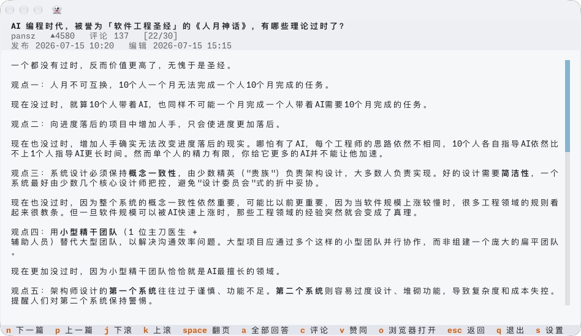

<p align="center">
  
</p>

<h1 align="center">zhihu-tui</h1>

<p align="center"><a href="README.md">中文</a> | English</p>

> Yet another Zhihu scraper. Just a small tool.

A little terminal app for browsing [Zhihu](https://www.zhihu.com) (China's Quora) without leaving your shell. Built for slacking off at work, written casually, good enough to use. Issues and suggestions are welcome.

The command is `zh`. The UI is built with [Textual](https://github.com/Textualize/textual), and data requests reuse [pyzhihu-cli](https://github.com/BAIGUANGMEI/zhihu-cli). Standing on the shoulders of others.

## Screenshot



## For your Agent

Copy the whole block below and paste it to your Agent (Claude Code, Codex, etc.). It will install everything and walk you through login:

```
Please install and log in to zhihu-tui (https://github.com/starr-evan/zhihu-tui), step by step:
1. Make sure Python 3.10+ is available; install it if not.
2. Run: pipx install git+https://github.com/starr-evan/zhihu-tui (install pipx first with pip install --user pipx if missing).
3. Run: pipx install pyzhihu-cli to get the `zhihu` command.
4. Run: zhihu login --qrcode, then open ~/.zhihu-cli/login_qrcode.png for me to scan with the Zhihu app and confirm. Wait up to 2 minutes; regenerate on timeout.
5. After login, run zhihu status to verify, then tell me to start with `zh` and the keys: 1/2/3 switch tabs, n/p page through, a all answers, s settings.
Never read, print, or upload my cookies. Credentials stay in ~/.zhihu-cli.
```

## Tip jar

It is just a small tool, and I am happy if it helps you. If you find it handy and feel like it, you can buy me a coffee. If not, a star or an issue is just as encouraging. (Alipay / WeChat Pay QR codes, mainland China only.)

<p>
  
  &nbsp;&nbsp;
  
</p>

## Features

- Three tabs: hot list, personalised feed, favourites
- Read answers and articles in the terminal: bold, quotes, lists, formulas, links
- Images and videos shown as clickable links that open in your browser
- Publish and edit times
- Jump from any answer to all answers of its question
- Read comments, upvote answers
- Five themes (light, dark, two colour-blind friendly, high contrast), switchable in settings
- Boss key `m`: instantly swaps the screen for a fake compiler log

## Install

Python 3.10+ is required. `pipx` or `pip` both work:

```
pipx install git+https://github.com/starr-evan/zhihu-tui
```

Or download the wheel from [Releases](https://github.com/starr-evan/zhihu-tui/releases):

```
pipx install ./zhihu_tui-0.2.0-py3-none-any.whl
```

For development:

```
git clone https://github.com/starr-evan/zhihu-tui
cd zhihu-tui
pip install -e .
```

## Usage

Log in once with pyzhihu-cli. Your cookie is stored locally in `~/.zhihu-cli`:

```
pipx install pyzhihu-cli
zhihu login --qrcode
```

Then start:

```
zh
```

## Keys

| Where | Keys |
|---|---|
| Home | `1` hot, `2` feed, `3` favourites, `↑↓` select, `Enter` open, `r` refresh, `s` settings, `m` boss key, `q` quit |
| Reading | `n`/`→` next, `p`/`←` previous, `j`/`k` scroll, `space` page down |
| Reading | `a` all answers, `c` comments, `v` upvote, `o` open in browser, `Esc` back |

## Data source

All content comes from Zhihu (zhihu.com).

## Disclaimer

1. This is a third-party open-source tool with no affiliation to Zhihu or its related companies. "Zhihu" is a trademark of its owner.
2. Content copyright belongs to the original authors and Zhihu. This software does not store, republish, or distribute content; it only displays data returned by the API in your terminal.
3. For personal learning and communication only. Follow Zhihu's terms of service and applicable laws; do not use it for bulk scraping or commercial purposes.
4. The API used is unofficial and may change or break at any time. Logging in carries a risk of account restrictions, which you accept yourself.
5. Credentials are stored only in `~/.zhihu-cli` on your machine and are never uploaded to any third party.
6. The software is provided as is, without warranty of any kind.

## License

[MIT](LICENSE). Free software: use, modify and distribute freely.
